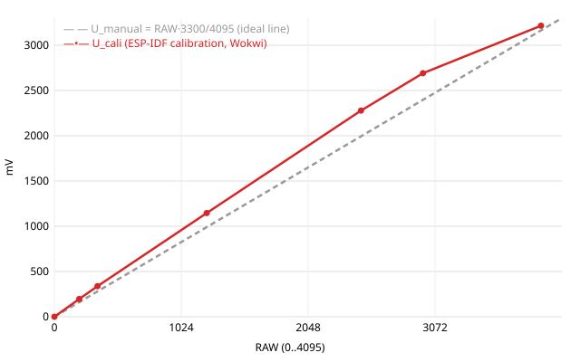

# Урок 32 — калібрування АЦП (результати з Wokwi)

ADC1_CH0 (GPIO1), атенюація 12 dB (вхід ~0…3100 мВ), 12 біт (0…4095), опорна для формули 3300 мВ.

| RAW | U_manual (mV) | U_cali (mV) | Error (%) |
|---:|---:|---:|---:|
| 0 | 0.0 | 0 | 0.00 |
| 200 | 161.2 | 196 | -17.77 |
| 348 | 280.4 | 338 | -17.03 |
| 1229 | 990.4 | 1146 | -13.58 |
| 2474 | 1993.7 | 2278 | -12.48 |
| 2974 | 2396.6 | 2691 | -10.94 |
| 3927 | 3164.6 | 3216 | -1.60 |

**Висновки**
- Проста формула RAW·3300/4095 занижує напругу на 11–18% майже по всьому діапазону: при атенюації 12 dB АЦП не лінійний від 0 до 3.3 В, і має зміщення внизу.
- Найбільша відносна похибка — на малих напругах (до ~0.3 В): зміщення в десятки мВ на тлі малого сигналу.
- Біля верхньої межі (~3.2 В) крива калібрування «загинається» і похибка падає до ~2% — ще одна нелінійна ділянка.
- Висновок: для вимірювань брати калібровані мВ (`adc_cali_raw_to_voltage`), а не формулу.

Дані з симуляції Wokwi (модель АЦП ESP32-S3), не з реального чипа; на залізі цифри будуть інші, бо калібрування індивідуальне для кожного чипа (eFuse).
