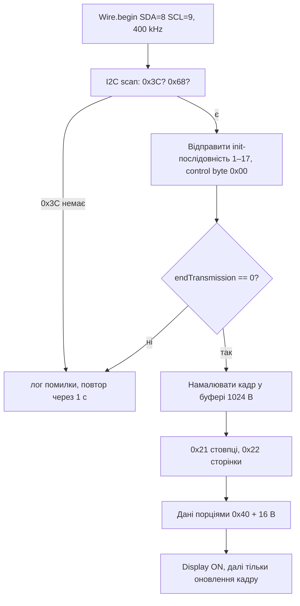

# Урок 41 · Модуль 4.2 — I²C: план роботи з дисплеєм SSD1306

Плата ESP32-S3: SDA = GPIO8, SCL = GPIO9, I²C 400 кГц.
Перевірка плану: `src/main.cpp` надсилає саме цю послідовність без бібліотеки, тільки через `Wire`. Симуляція: [Wokwi](https://wokwi.com/projects/481342940277582849).

## 1. Компоненти на шині

| Пристрій | Що це | I²C адреса (7 біт) | Головне з даташиту |
|----------|-------|--------------------|--------------------|
| SSD1306 | контролер OLED 128×64 | 0x3C (SA0=0) або 0x3D | Після адреси йде керуючий байт: 0x00 — далі команди, 0x40 — далі дані (GDDRAM). Пам'ять: 8 сторінок × 128 стовпців, 1 байт = 8 вертикальних пікселів. |
| DS1307 | годинник реального часу (RTC) | 0x68 | Регістри 0x00–0x06: сек, хв, год, день тижня, дата, місяць, рік у BCD. Біт CH (0x00, біт 7) = 1 зупиняє годинник. 0x07 — керування виходом SQW. 0x08–0x3F — 56 байт RAM. |
| AT24C32E | EEPROM 32 Кбіт (4096 × 8) | 0x50–0x57 (A2..A0) | Адреса комірки — 2 байти (старший, молодший). Запис сторінками до 32 байт; після запису ~5 мс чип не відповідає (ACK polling). |

## 2. Формат транзакції SSD1306

```
START | 0x3C<<1 | W | ACK | керуючий байт | ACK | байт 1 | ACK | ... | STOP
```

- Команди: `[0x00, cmd, arg, cmd, ...]`
- Дані: `[0x40, d0, d1, ...]`. У `Wire` буфер 128 байт, тому дані шлю порціями по 16 байт.

## 3. План ініціалізації (128×64)

| # | Команда | Байти | Навіщо |
|---|---------|-------|--------|
| 1 | Display OFF | `AE` | вимкнути, поки налаштовуємо |
| 2 | Clock divide / osc freq | `D5 80` | частота оновлення за замовчуванням |
| 3 | Set multiplex ratio | `A8 3F` | висота 64 рядки (для 32 — `1F`) |
| 4 | Set display offset | `D3 00` | без зсуву |
| 5 | Set start line | `40` | рядок 0 |
| 6 | Charge pump | `8D 14` | увімкнути внутрішній підвищувач (живлення від 3.3 В) |
| 7 | Memory addressing mode | `20 00` | горизонтальний: після кінця рядка перехід на наступну сторінку |
| 8 | Segment remap | `A1` | стовпець 127 → SEG0 (дзеркало по X, щоб не було «навиворіт») |
| 9 | COM scan direction | `C8` | сканувати знизу вгору (дзеркало по Y) |
| 10 | COM pins config | `DA 12` | альтернативна конфігурація для 64 рядків (для 32 — `02`) |
| 11 | Contrast | `81 CF` | яскравість |
| 12 | Pre-charge period | `D9 F1` | для внутрішнього charge pump |
| 13 | VCOMH deselect level | `DB 40` | рівень VCOMH |
| 14 | Entire display ON → resume | `A4` | показувати вміст RAM |
| 15 | Normal display | `A6` | не інверсний |
| 16 | Deactivate scroll | `2E` | вимкнути прокрутку |
| 17 | Display ON | `AF` | увімкнути |

## 4. Вивід картинки

1. Межі стовпців: `[0x00, 0x21, 0x00, 0x7F]` (0…127).
2. Межі сторінок: `[0x00, 0x22, 0x00, 0x07]` (0…7).
3. 1024 байти буфера: 64 транзакції `[0x40, 16 байт]`.

## 5. Блок-схема



## 6. Джерела

- SSD1306: https://files.waveshare.com/upload/a/af/SSD1306-Revision_1.1.pdf (розділ 9, Command Table; 8.1.5, I²C interface)
- DS1307: https://eu.mouser.com/datasheet/3/1014/1/DS1307.pdf (Timekeeper registers)
- AT24C32E: https://eu.mouser.com/datasheet/3/282/1/AT24C32E_I2C_Compatible__Two_Wire__Serial_EEPROM_32_Kbit__4_096x8__20006109B.pdf
